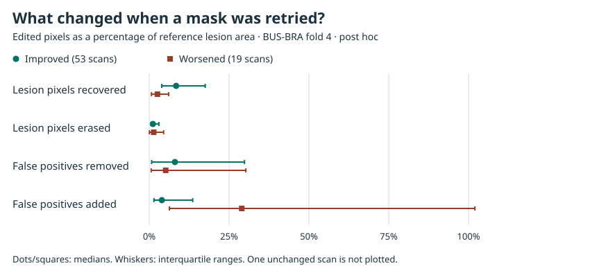

# Recoverable errors in breast ultrasound segmentation

Can a model predict **which first-pass masks a second pass will improve**, rather than simply which masks are uncertain? This is a research pipeline, not a diagnostic tool. The first-pass segmenter and refiner are identical across routing policies. Their second-pass assignments differ.

**Independent MSc research pilot — completed; router training stopped by the prespecified rule.** On 365 BUS-BRA scans from 214 held-out development patients, entropy-based retries improved segmentation. Even perfect hindsight did not add enough over entropy to justify training a router at this budget.

| Policy on fold 4 | Retries | Patient-macro lesion Dice |
|---|---:|---:|
| First pass only | 0 | 0.85808 |
| Highest first-pass entropy | 73 | 0.86830 |
| Best possible allocation (oracle; requires reference masks) | 73 | 0.87737 |

**Decision:** oracle minus entropy was **+0.00907**, below the predeclared **+0.01000** gate. The two policies shared 35 retries and each chose 38 different scans. No router was fitted to clinical data; fold 5, BrEaST and BUS-UCLM were **not scored**. [Pilot results and overlap analysis](closeout/PILOT-CLOSEOUT.md) · [Protocol](PROTOCOL.md) · [Dataset sources and terms](DATA.md).

**Post-hoc: what went wrong on individual retries?** Of 73 entropy-selected retries, 53 improved, 19 worsened and one was unchanged. All 19 worsened scans had the entire reference lesion inside the crop. In 16 of those 19, refinement increased the number of false-positive pixels. The chart distinguishes extra background included from correctly segmented lesion tissue erased; these are reference-mask comparisons, not clinical diagnoses. [Methods and full aggregate results](closeout/MASK-AUDIT.md).



For historical replay, use the [prepilot tag](https://github.com/mehbakh82/recoverable-us-segmentation/tree/prepilot). It was imported for this release from the original verified pre-pilot ZIP, not timestamped on GitHub before training. The public release contains code, documentation and aggregate findings only.

## Try it without medical data

From this directory, use Python 3.12 in a fresh environment. On a CPU machine:

```sh
python3.12 -m venv .venv
. .venv/bin/activate
python -m pip install -r requirements.txt
python -m unittest discover -s tests -v
python -m rus demo --run runs/demo
python -m rus report --run runs/demo
```

Open **runs/demo/report/REPORT.md**. It links to the curves; metrics.json contains patient-level intervals and policy outcomes. The demo fits real, small models to generated images. It exercises the entire pipeline **even when the synthetic pilot fails**. No such exception exists in clinical runs. Use a fresh demo directory for each invocation.

## CPU reference on real development data

After preparing a clinical manifest, run `python -m scripts.cpu_reference --run runs/msc`. This optional check asks how much overlap comes from lesion position alone. For each BUS-BRA development fold, it learns one fixed mask from the other two folds' annotations, weighting patients equally. It predicts using frame dimensions only. No pilot or test annotations are loaded and the output does not enter model selection or the go/no-go gate.

On the pinned releases the development-only run covered 1,127 images from 638 patients. The patient-macro Dice was **0.2353** (folds: 0.2192, 0.2460, 0.2408); the template had zero overlap on 160 images. These are reference-mask results, not U-Net performance. Per-fold counts and scores are written to `cpu-reference.json` in the run directory.

## Review development failures on CPU

The blank [review worksheet and scoring guide](FAILURE-REVIEW.md) can be used now. Once all three development cross-fit folds exist, run `python -m scripts.failure_review --run runs/msc`. To rehearse without clinical predictions, use `--run runs/demo` after the CPU demo. The generator creates a private editable Markdown worksheet and side-by-side panels in the run's `failure-review/` directory. It checks held-out patient provenance and sampled mask scores, never substitutes pilot/test cases, and refuses to overwrite reviewer notes.

## How much can two equal-budget routers differ?

Run `python -m scripts.design_sensitivity --output runs/design-sensitivity.json`. This **simulation** uses only the planned cohort size: 256 scans, one per patient, including 252 positives and four normals. Both policies retry 51. Shared decisions cancel. In each simulated cohort the four normals are placed uniformly without replacement; they consume retry slots but do not enter positive-patient Dice. On exclusive positive scans, refinement changes Dice by +0.20 or −0.20. Difficulty-only retries have equal chances of helping or hurting; recovery-only retries have an assumed mean change of 0, +0.05 or +0.10. Effects are independent across patients. The expected cohort contrast is the number of swaps times this assumed advantage divided by 256.

For each scenario the script draws 1,000 cohorts and computes a 2,000-resample patient-bootstrap lower bound on each, holding decisions fixed. Multinomial draws of the three possible paired patient differences are equivalent to resampling the 252 patients. Results describe sensitivity to overlap **under these assumptions**; they are not a power estimate from clinical data. The actual study will report the observed overlap and paired interval. For a new rehearsal use a fresh demo directory; old frozen runs remain bound to their original code and protocol.

## Run on the allocated H100 NVL

Use a CUDA-enabled PyTorch 2.9.1 installation compatible with the host driver. For example, in a fresh Linux environment with a CUDA 12.8-compatible driver, install the matching wheel first, then the requirements. Do not run these commands on a login node or select a GPU outside your allocation.

```sh
python3.12 -m venv .venv
. .venv/bin/activate
python -m pip install torch==2.9.1 --index-url https://download.pytorch.org/whl/cu128
python -m pip install -r requirements.txt
python -m pip check
export RUS_GPU_SHARED=unknown
export RUS_SCHEDULER_LIMIT='estimated 24 GB; verify with administrator'
```

Read the dataset terms linked in DATA.md first. On the machine that will train the models:

```sh
python scripts/fetch_public.py --root data
UCLM="data/BUS-UCLM Breast ultrasound lesion segmentation dataset/BUS-UCLM"
RUN=runs/msc
python -m rus prepare --run "$RUN" --busbra data/BUSBRA \
  --breast data/BrEaST-Lesions_USG-images_and_masks --breast-sheet data/breast.xlsx \
  --uclm-images "$UCLM/images" --uclm-masks "$UCLM/masks" --uclm-csv "$UCLM/INFO.csv"
# Transfer the original prepilot.zip into "$RUN" when moving an existing study to the GPU.
# For a NEW study only, create the archive once:
if [ ! -f "$RUN/prepilot.zip" ]; then python -m rus.snapshot create --run "$RUN"; fi
python -m rus.snapshot verify --run "$RUN"
python -m rus profile --run "$RUN"
python -m rus train --run "$RUN"
python -m rus pilot --run "$RUN"
python -m rus report --run "$RUN"
```

Preparation writes **counts.json**, a versioned-by-content manifest and duplicate review. Paths are local to the machine: re-prepare on the GPU host instead of copying an absolute-path manifest. If near duplicates need adjudication, follow DATA.md. Inspect hardware.json: both networks must complete a forward, backward and optimizer step. The PyTorch allocator is capped at **20 billion bytes**; this is not a scheduler reservation or a cap on other processes. Caches/context outside that allocator can add overhead. Models train **sequentially** using BF16, GroupNorm and effective batch size 8. Microbatch 4 falls back to 2, then 1. A training OOM resumes from the last completed epoch; rerun the same stage after preemption. A failed 1-image batch pauses the study rather than changing resolution.

**Snapshot handoff:** keep the original ZIP and its SHA-256 separately. The archive contains allowlisted source, tests, docs, package versions and manifest digests, not patient rows, masks, predictions or weights. Verification tolerates relocated image/mask paths when the ordered cases, folds and content hashes match. It checks pinned package base versions (a CUDA wheel may have a local version suffix); the scoring receipt records the actual runtime. This is a local reproducibility record, not a third-party timestamp or a public registration.

**Check the pilot before spending more GPU time.** If gate.json says false, stop here: the pilot report is the result. Only on a passing clinical pilot:

```sh
python -m rus crossfit --run "$RUN"
python -m rus fit-router --run "$RUN"
python -m rus freeze --run "$RUN"
python -m rus evaluate --run "$RUN"
python -m rus report --run "$RUN"
```

Cross-fitting is three rotations of two segmenters each, in addition to the original two fits. Freeze binds source code, manifest, both final checkpoints, router, threshold and pilot. Do not edit them between freeze and evaluation. The frozen evaluation is not a tuning loop. Failure due to interruption can be retried on the identical freeze; after completion only report replay is supported. Keep data and runs private by default: their manifests, predictions, masks and checkpoints are **not** intended for GitHub.

## Outputs

| Location relative to run | Meaning |
|---|---|
| counts.json, manifest.json, duplicate-review.json | Eligibility, fold origin, patient grouping, file hashes and exclusions |
| models/development/ | Resumable checkpoints and per-model epoch ledgers: seed/config in checkpoint, loss, seconds, allocated/reserved bytes and microbatch |
| pilot/gate.json | Score and headroom of the impossible oracle relative to entropy and first pass; fraction helped/harmed |
| crossfit/1 through crossfit/3 | Out-of-fold pairs, checkpoint hashes, training and held-out patient lists |
| router.json, freeze.json | Human-readable boosted trees, source-calibrated threshold and frozen inputs |
| evaluation/{internal,breast,uclm}/ | Private native-resolution mask pairs, per-image score/features/cost records, separate threshold-policy timing |
| report/ | Paper-style results table, per-cohort curves and aggregate metrics; re-created by one report command without retraining |

Release **code, protocol and vetted aggregates** regardless of outcome. Do not publish licensed data, raw masks, subject identifiers or employer artifacts. Only distribute trained weights after an explicit rights review.
