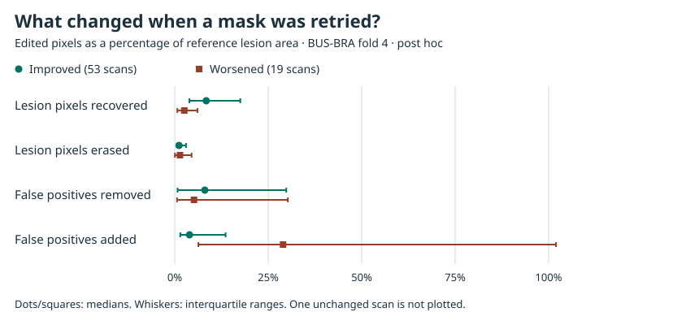

# Which pixel changes accounted for worse contours?

**Post-hoc description, not a new test of the gate.** We replayed the frozen entropy policy and inspected all 73 of its retries (61 patients). Both stored native-resolution Dice scores were reproduced for every scan, and the reference mask file hashes matched the manifest. Of the 73 scans, 53 improved, 19 worsened, and one was unchanged in Dice. These are mask comparisons, not clinical outcomes.

## Where the edits occurred

| Median edit size, as % of reference lesion area | Improved (n=53) | Worsened (n=19) |
|---|---:|---:|
| Reference lesion pixels recovered | 8.4% | 2.6% |
| Previously correct lesion pixels erased | 1.2% | 1.4% |
| False-positive pixels removed | 8.0% | 5.2% |
| New false-positive pixels added | 3.9% | 29.0% |

These are four separate per-scan medians, not pixel totals or components that can be subtracted to obtain a median Dice change. A false-positive edit size can exceed 100% because the denominator is reference lesion area, not frame area. The unchanged scan remains in the overall counts.

- **Background expansion:** in 16 of 19 worsened scans, the second mask had more false-positive pixels than the first. This also happened in 21 of 53 improved scans: expansion alone does not imply that Dice worsens if enough lesion pixels are recovered.
- **Lesion loss:** 8 of 19 worsened scans had a net loss of correctly labeled lesion pixels. This can coexist with background expansion. Using the exact per-scan Dice decomposition below, the adverse background term outweighed the lesion term in 13 of the 19 worsened scans; the reverse held in six.
- **Crop coverage:** the reconstructed crop contained the entire annotated lesion in all 19 worsened scans. Only four of all 73 selected scans had any reference lesion tissue outside their crop. This rules out clipping of reference pixels as an explanation for these 19 declines; it does not rule out effects of scale, context, or model behavior inside the crop.

## How the check works

Let **R** be recovered lesion pixels, **E** erased lesion pixels, **F** false positives removed and **A** false positives added. With first-pass Dice **D₁**, reference area **G** and second-pass predicted area **P₂**, the exact change is:

**D₂ − D₁ = [(2 − D₁)(R − E) + D₁(F − A)] / (G + P₂).**

The script checks this identity for every audited scan, verifies that the second mask is contained within the frozen model's crop, and checks the Dice ceiling obtainable by segmenting all reference pixels inside that crop. It does not search for tuning thresholds. The quartiles are descriptive and frame-weighted; they do not replace the patient-macro pilot endpoint or establish causation.

## Decision

Leave the original study stopped. If pursuing a **separate** experiment, prioritize a refiner that limits unsupported additions outside the first mask, **not** a larger crop or a blanket ban on expansion. Compare it to unrestricted refinement on both false positives added and true lesion pixels recovered. Use development data to design it, freeze a new protocol, and obtain an independent evaluation; do not use this fold again as confirmation.

## Reproduction

- [Aggregate JSON](mask-audit.aggregate.json) · [CPU audit code](mask_audit.py) · [Figure generator](plot_mask_edits.py).
- Regenerate the public figure without any clinical data: `python closeout/plot_mask_edits.py`.
- On the private study host, run from the **frozen** source tree and provide the audit script from this release: `CUDA_VISIBLE_DEVICES="" venv/bin/python - runs/msc < /path/to/release/closeout/mask_audit.py`. It emits group statistics only; scans, reference masks and prediction masks stay on the host.
